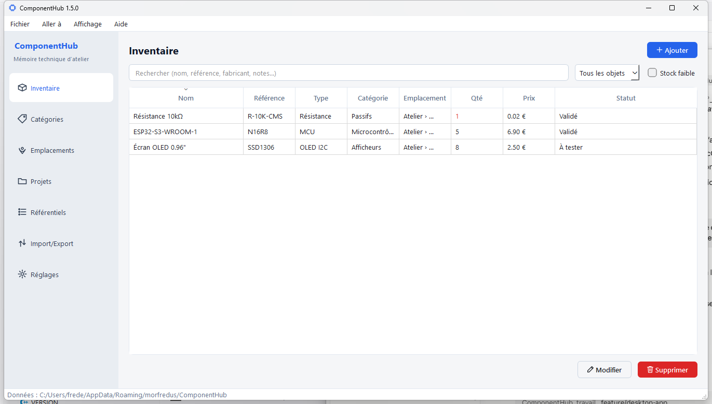
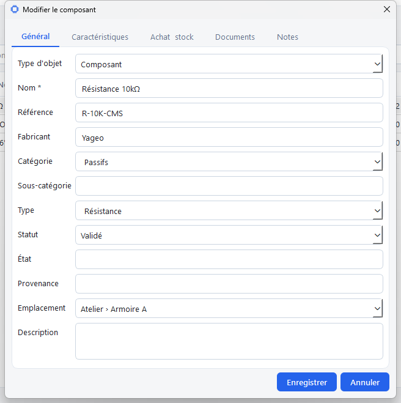
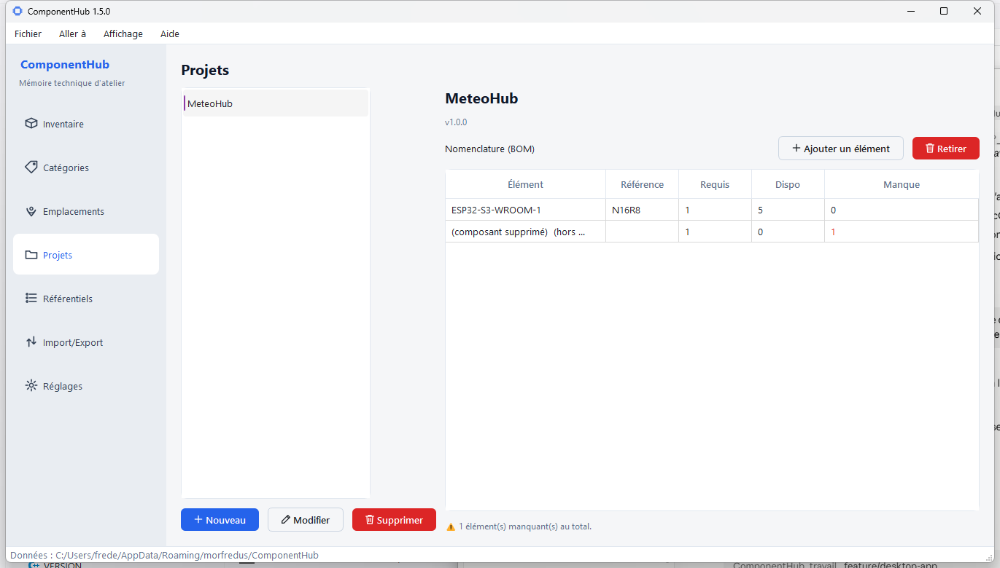
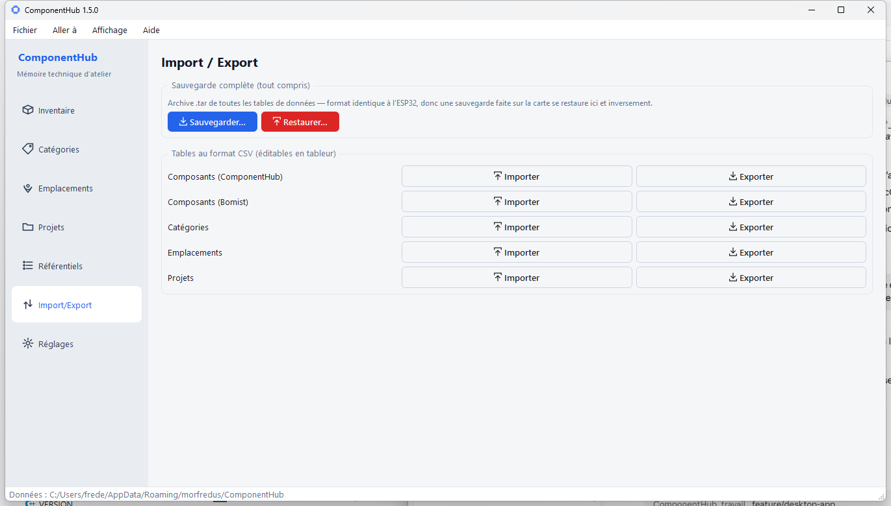

# ComponentHub

*Lire dans une autre langue : [English](README.md) · **Français** (ce document).*

[](CHANGELOG.md)


**La mémoire technique d'un atelier électronique** : inventaire de composants,
modules, outils et consommables ; stock et mouvements ; emplacements
hiérarchiques ; documentation attachée ; projets et leur nomenclature.

Ce n'est pas un simple inventaire : l'objectif est de retrouver en un clic, pour
n'importe quel composant, son stock, son emplacement, ses datasheets et les
projets qui l'utilisent.



ComponentHub est une **application de bureau Qt / C++17**, native sur
**Windows, Linux (x86_64) et Raspberry Pi (ARM64)**. C'est le **projet maître**,
détenteur de la base de données de référence de l'atelier - sur un stockage
fiable, sans les limites mémoire de l'ESP32. La piste d'un satellite ESP32 a
été abandonnée : ComponentHub est désormais un produit de bureau autonome.
L'ancien choix maître/satellite reste consigné dans
[docs/fr/ADR-0001](docs/fr/ADR-0001-desktop-maitre-esp32-satellite.md), à titre
historique.

## Débuter en 3 minutes

Jamais compilé un programme ? C'est le bon endroit pour commencer - et c'est
**exactement aussi simple sous Linux/Raspberry Pi que sous Windows** (souvent
plus rapide). Suivez le guide pas à pas :
**[docs/fr/GETTING_STARTED.md](docs/fr/GETTING_STARTED.md)**.

Une fois l'application lancée, le mode d'emploi débutant est là :
**[docs/fr/USER_MANUAL.md](docs/fr/USER_MANUAL.md)**.

## Cœur métier

Le cœur métier [`src/domain/`](src/domain/) - entités, services (inventaire,
projets, documents, import/export), CSV - ne dépend ni de Qt ni d'Arduino. Cette
séparation en couches (domaine ⟷ stockage ⟷ interface) est décrite dans
[docs/fr/ARCHITECTURE.md](docs/fr/ARCHITECTURE.md).

L'application bureau regroupe les données de l'atelier dans une base SQLite
locale (`componenthub.sqlite`) et les sauvegarde dans une archive `.tar` unique.
Les imports et exports CSV restent disponibles dans l'application.

## Supervision réseau et mises à jour

ComponentHub annonce sa présence sur le réseau local et expose ses métriques
(module **morfBeacon**), pour être suivi depuis un tableau de bord central, et
vérifie les mises à jour depuis GitHub (module **morfUpdate**, menu Aide). Ces
modules communs sont inclus dans le projet (`third_party/morf/`) et compilés dans
l'exécutable - rien d'externe à installer. Voir
[docs/fr/SUPERVISION_ET_MAJ.md](docs/fr/SUPERVISION_ET_MAJ.md).

## Aperçu

**Fiche composant** - tout sur un composant (général, caractéristiques, achat/
stock, documents, notes) :



Dans l'inventaire, survoler un composant affiche sa première photo jointe, sans
ouvrir la fiche.

**Projets** - nomenclature (BOM) et calcul des composants manquants :



**Import / Export** - sauvegarde complète `.tar` et CSV par table :



## Compilation (bureau)

Dépendances : CMake ≥ 3.21, un compilateur C++17, Ninja, **Qt 6 (Widgets)**,
**SQLite 3** et **nlohmann-json** (utilisé par le protocole de synchronisation).
Guide détaillé et pas à pas (débutant compris) :
[docs/fr/GETTING_STARTED.md](docs/fr/GETTING_STARTED.md) ; référence
multi-plateforme : [docs/fr/BUILD_DESKTOP.md](docs/fr/BUILD_DESKTOP.md).

### Windows (MSYS2 / MinGW)

```sh
cmake --preset mingw
cmake --build --preset mingw
# -> build-mingw/ComponentHub.exe (DLL Qt + MinGW déployées automatiquement)
```

Sous VS Code : les tâches **CMake: Build (MinGW)** et **ComponentHub: Run**
(`.vscode/tasks.json`) font la même chose en un raccourci.

### Linux (x86_64) / Raspberry Pi (ARM64)

```sh
cmake --preset linux        # ou linux-arm64 sur Raspberry Pi
cmake --build --preset linux
```

## Paquets distribuables

Les scripts de packaging sont dans `scripts/` :

```sh
# Windows : ZIP autonome (exe + DLL + plugins Qt)
powershell -ExecutionPolicy Bypass -File scripts\windows\package-win.ps1

# Linux : paquet Debian (.deb, lié au Qt du système)
scripts/linux/package-deb.sh

# Linux : AppImage autonome (Qt embarqué)
scripts/linux/package-appimage.sh

# Linux : intégration au menu du bureau (binaire déjà compilé)
scripts/linux/install.sh
```

Les artefacts sont produits dans `dist/`.

## Structure du dépôt

```
ComponentHub/
├── CMakeLists.txt          application bureau (cible principale)
├── CMakePresets.json       presets mingw / linux / linux-arm64 / cross
├── cmake/toolchains/       toolchain de cross-compilation ARM64
├── scripts/{windows,linux}/ compilation VS Code + packaging (zip, deb, AppImage)
├── resources/              app.qrc, thèmes (light/dark), icône (logo.png, app.ico)
├── src/
│   ├── domain/             cœur métier (aucune dépendance Qt/Arduino)
│   ├── ui/                 interface Qt (Theme, Icons, pages, dialogues)
│   ├── storage/            dépôts SQLite (desktop)
│   ├── platform/           archive .tar, horloge
│   └── main.cpp
├── docs/
│   ├── fr/                 documentation (français, langue de référence)
│   ├── en/                 index anglais (renvoie vers fr/ pour l'instant)
│   └── pictures/           captures d'écran
├── CONTRIBUTING.md         philosophie du projet et règles de contribution
├── VERSION                 version de l'application bureau
└── LICENSE
```

## Documentation

| Document | Contenu |
|---|---|
| [docs/fr/GETTING_STARTED.md](docs/fr/GETTING_STARTED.md) | Cloner, installer les outils, compiler et lancer - pas à pas, tous OS, débutant compris |
| [docs/fr/USER_MANUAL.md](docs/fr/USER_MANUAL.md) | Mode d'emploi de l'application, pour bien démarrer |
| [docs/fr/BUILD_DESKTOP.md](docs/fr/BUILD_DESKTOP.md) | Référence de compilation multi-plateforme |
| [docs/fr/ARCHITECTURE.md](docs/fr/ARCHITECTURE.md) | Architecture en couches (domaine / stockage / interface) |
| [docs/fr/ADR-0001](docs/fr/ADR-0001-desktop-maitre-esp32-satellite.md) | Historique de l'ancienne piste maître/satellite ESP32 |
| [CONTRIBUTING.md](CONTRIBUTING.md) | Comment contribuer, règles de portabilité |
| [CHANGELOG.md](CHANGELOG.md) | Historique des versions |


## Licence

Distribué sous [licence GPL-3.0-only](LICENSE).
