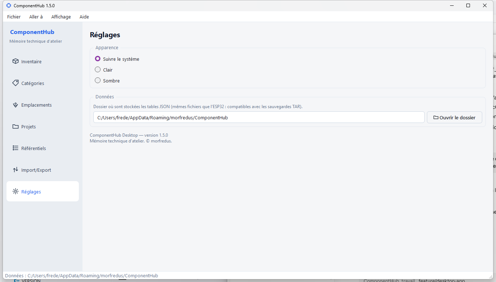

# ComponentHub - version bureau (Windows / Linux / Raspberry Pi)

Application native **Qt 6 / C++17**. C'est le **projet maître** de ComponentHub,
détenteur de la base de référence de l'atelier, sur PC ou Raspberry Pi - sans la
contrainte mémoire de l'ESP32. La piste ESP32 est abandonnée ; l'ADR associé est
conservé uniquement comme [historique](ADR-0001-desktop-maitre-esp32-satellite.md).

## Cœur métier et format de données

- **Domaine** (`../src/domain/`) : entités, services (`InventoryService`,
  `ProjectService`, `ImportExportService`…), CSV - sans aucune dépendance à la
  plateforme (ni Qt, ni système embarqué). Ce dépôt en détient sa propre copie.
- **Format des données** : une base SQLite `componenthub.sqlite` regroupe les
  tables de l'atelier ; une sauvegarde `.tar` (menu Import/Export) réunit les
  données et la configuration dans un seul fichier.

Spécifique au bureau : le **stockage SQLite** (`storage/`), l'archive
`.tar` (`platform/Tar.cpp`) et l'**interface Qt** (`ui/`).

## Dépendances

- CMake ≥ 3.21, un compilateur C++17, Ninja
- Qt 6 (module *Widgets*)
- SQLite 3 et ses en-têtes de développement
- nlohmann-json (protocole de synchronisation)

## Compilation

### Windows (MSYS2 / MinGW)

Paquets : `mingw-w64-x86_64-{gcc,cmake,ninja,qt6-base,nlohmann-json}`.

```sh
cmake --preset mingw
cmake --build --preset mingw
# -> build-mingw/ComponentHub.exe (DLL Qt copiées automatiquement)
```

### Linux (x86_64)

Paquets (Debian/Ubuntu/Mint) : `cmake ninja-build qt6-base-dev nlohmann-json3-dev`.

```sh
cmake --preset linux
cmake --build --preset linux
# -> build/ComponentHub
```

### Raspberry Pi (Linux ARM64, compilation native)

Mêmes paquets que Linux, puis :

```sh
cmake --preset linux-arm64
cmake --build --preset linux-arm64
```

### Cross-compilation ARM64 depuis un PC x86_64

Nécessite une toolchain `aarch64-linux-gnu-` et un sysroot ARM64 (avec Qt6).
Renseigner `CH_SYSROOT` (et éventuellement `CH_CROSS_PREFIX`), puis :

```sh
CH_SYSROOT=/chemin/sysroot cmake --preset linux-arm64-cross
cmake --build --preset linux-arm64-cross
```

## Données

Les fichiers de données vivent dans le dossier de configuration utilisateur
(`QStandardPaths::AppDataLocation`) :

- Windows : `%APPDATA%\morfredus\ComponentHub`
  (soit `C:\Users\<compte>\AppData\Roaming\morfredus\ComponentHub`)
- Linux : `~/.local/share/morfredus/ComponentHub` (ou `~/.config/...` selon la distro)

où `<compte>` est votre nom d'utilisateur et `morfredus` le dossier de l'éditeur
(le même pour tout le monde).

Le chemin exact est affiché dans la barre de statut et sous *Réglages*, d'où l'on
choisit aussi le thème (clair / sombre / système) :


